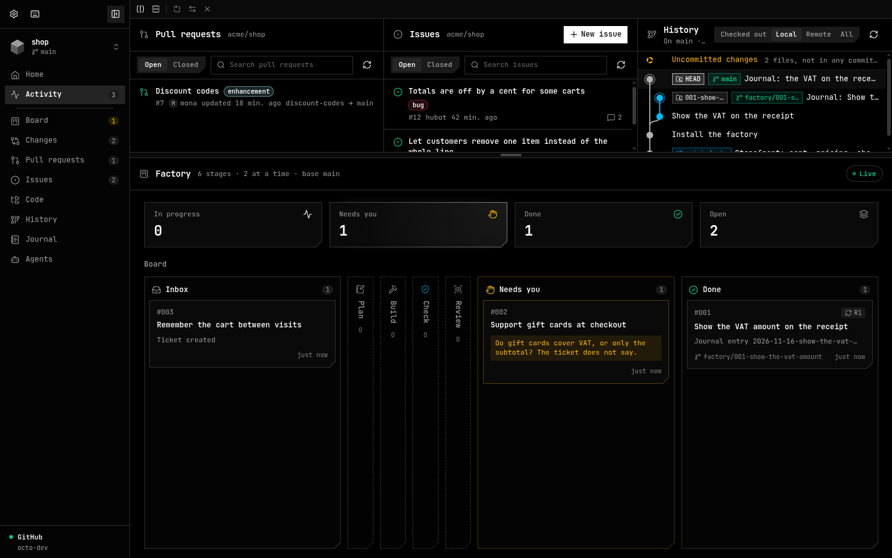
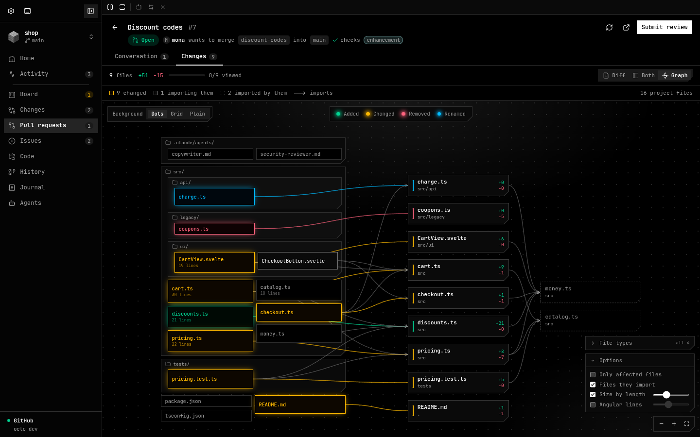
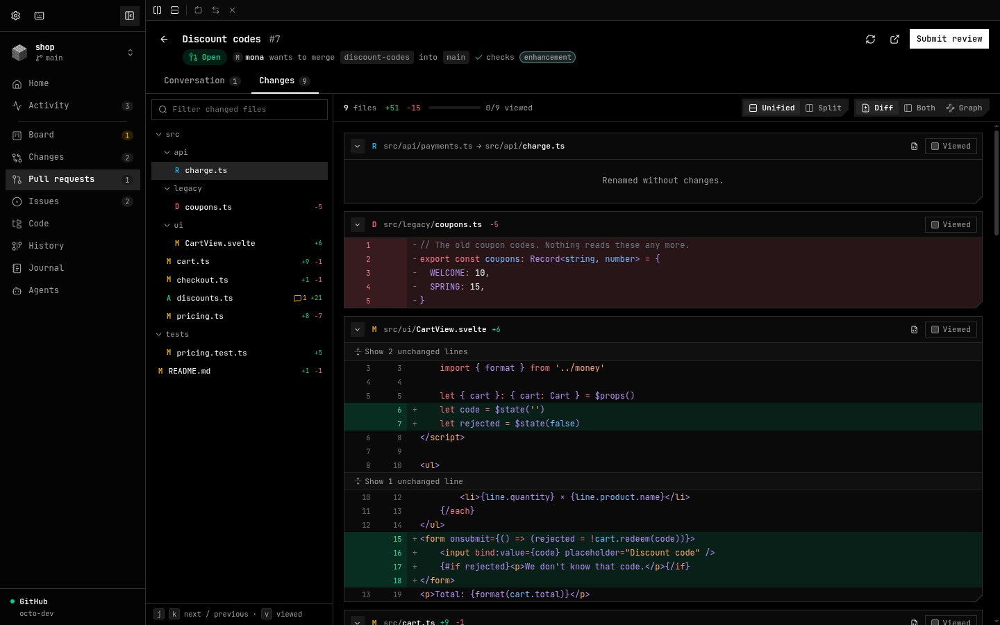

# Portable Project Factory



**A software factory you drop into any repo.** 🏭

Say what you want built. A pipeline plans it, builds it on its own branch, runs your checks, reviews it, and writes down **why** it changed. It works with Claude Code and with Codex, and a desktop app, called **Factory**, shows you where everything is.

It is made to sit beside the way you already work with coding agents. You keep your editor, your prompts and your git habits. What you gain is a clear view of what the agents are doing, and one place to steer them.

> 🚧 **Version 1.0, and young.** It is built and tested on Linux. The Windows and macOS apps are built by the same pipeline but have been run on far fewer machines: please tell us what you run into in the [issues](https://github.com/RT-codes/portable-project-factory/issues).

## 📦 Install

Run this **inside the repo you want it in**. The same command works on Linux, macOS and Windows, and needs no admin rights:

```bash
npx -y github:RT-codes/portable-project-factory
```

You need [Node.js](https://nodejs.org) 20 or newer, git, and at least one agent CLI: [Claude Code](https://claude.com/claude-code) (`claude`) or Codex (`codex`).

It adds three things to the repo, and nothing else:

- `.factory/`: one hidden folder with the pipeline, your settings and the journal.
- A ten-line block in `AGENTS.md`, so any agent that starts in the repo knows the workflow.
- The `/factory` skill for Claude Code, under `.claude/skills/factory/`.

Then tell it about your project and commit:

1. Put your checks (lint, tests, build) in `.factory/config.json`.
2. Put your stack and conventions in `.factory/rules.md`.
3. Commit the new files.

`npx -y github:RT-codes/portable-project-factory --update` refreshes it later, and `--remove` takes it out again.

### 🤖 Are you an agent?

If someone gave you this page and asked you to install the factory, do this:

1. `cd` into the user's repo (it must be a git repo) and run `npx -y github:RT-codes/portable-project-factory`.
2. Read the block it added to `AGENTS.md`, then run `node .factory/cli.mjs doctor` to see what is still missing.
3. Fill in `.factory/config.json` with the repo's real check commands and `.factory/rules.md` with its stack and conventions. Ask the user when you cannot tell.
4. Show the user what was added and let them commit it. Do not commit or push for them unless they ask.
5. From then on, follow the workflow in `AGENTS.md`: work goes through tickets, and `node .factory/cli.mjs context` tells you what to know before you start.

## 🚀 Use it

Any agent that starts in the repo reads `AGENTS.md` and knows what to do, so you can simply say what you want built. Or drive it yourself:

```bash
node .factory/cli.mjs new "Add a dark mode toggle to settings"
node .factory/cli.mjs run --detach     # plan, build, check, review, journal
node .factory/cli.mjs status
node .factory/cli.mjs start            # open the Factory app here (stop closes it)
node .factory/cli.mjs context          # what an agent should know before it works
node .factory/cli.mjs recall "vat rounding"   # why did that change?
```

In Claude Code, `/factory start` and `/factory stop` open and close the app.

A ticket moves through **plan, build, check, review**. When it is done it is reviewed and ready on its own branch: merging it is your call.

## ✨ What you get

- **A pipeline for any agent.** It starts its own planner, builder and reviewer with the agent CLI you use, on that CLI's default model. You can pick the model and effort per role in the app.

- **A journal of why.** Every finished ticket leaves a committed entry: what changed, why, the decisions made, and what to watch out for, with the commits and files from git. Agents load it in layers (recent changes in full, older ones in a line) and look up the rest when they need it, so they do not loop or undo earlier work.

- **A desktop app.** It is installed once per user in your home folder, the first time you run `start`. It works in any git repo, with or without a factory.

- **Rules, roles and skills you can edit.** How agents behave in the repo lives in plain files. The app has an editor for them, with a guide to writing repo-specific skills.

- **Yours stays yours.** Themes, layout, shortcuts and model choices stay on your machine. The journal holds summaries and facts, never your prompts.

## 🖥️ The Factory app



| View | What it is for |
|---|---|
| **Home** | What needs you, the numbers, the latest changes and why, setup, and where to change how agents work. |
| **Activity** | Pull requests, issues and the history in a strip, over the board. |
| **Board** | The tickets, live. A ticket's branch opens in the diff viewer. |
| **Changes** | The uncommitted work, or any branch against the base branch, as a diff, a graph, or both. |
| **Pull requests** | Review: diff, comments on lines sent as one review, threads, checks, merge. |
| **Issues** | Read, comment, close, create. *Send to factory* files one as a ticket. |
| **Code** | The project's files, highlighted. |
| **History** | The commits as a graph, with branches, tags and every worktree. |
| **Journal** | Why things changed: a timeline, searchable, linked to commits and files. |
| **Agents** | The files agents read (rules, roles, skills, `AGENTS.md`), with an editor. |

A few things worth knowing:

- **The graph** shows a change against the whole project: every folder and file on the left, the changed files lit up in the colour of what happened to them, and arrows from every file that imports them.
- **Panels** split like a tiling window manager, so a diff, the board and a file can sit side by side.
- **Keyboard shortcuts** are all listed and can be changed (`Ctrl+Alt+K`).
- **Themes** are yours to make: colours, borders, cut corners, fonts and spacing.
- **GitHub** goes through the [`gh` CLI](https://cli.github.com) you are signed in to, so there is no token to paste. Without it, everything local still works.



The app is not code-signed yet, so macOS and Windows warn the first time you open it.

## 🗂️ What is saved where

| Where | What | Shared? |
|---|---|---|
| `.factory/` in the repo | The pipeline, your checks, rules, roles, skills, tickets and the journal | Yes, committed with the repo |
| `AGENTS.md`, `.claude/skills/factory/` | What tells agents how to work here | Yes, committed |
| `.factory/local.json` | Your own model and effort choices | No, git ignores it |
| `~/.factory/app/` | The Factory app itself | No, on your machine |
| The app's own storage | Themes, layout, shortcuts, recent projects | No, on your machine |

## 📚 More

[docs/FACTORY.md](docs/FACTORY.md) explains how all of it works: the pipeline, the journal, skills, the app, and how to develop this repo.

```
install.mjs    the installer
kit/           what gets installed, and its tests (npm test)
app/           the desktop app (cd app && npm install && npm run demo)
docs/          how it all works
```

## 🤝 Contributing

Found a bug or have an idea? Open an [issue](https://github.com/RT-codes/portable-project-factory/issues). Pull requests are welcome: run `npm test` in the root and `npm run check && npm test` in `app/` before you send one.

## 📄 License

Portable Project Factory is open source under the [Apache License 2.0](LICENSE): free to use, change and share, including commercially.
